# PeriMove: adapting a home workout to how you feel today

## What it is

PeriMove helps women approaching or experiencing perimenopause adapt a home workout to how they feel today. I built the prototype solo during the three-day Lovable SheBuilds hackathon in October 2026.

I owned the problem framing, research, product decisions, design direction, content, testing and release decisions. I used Lovable to build the app from my specifications, with ChatGPT and Claude supporting research synthesis, planning, review and documentation.

[Explore the current prototype](https://perimove.lovable.app) · Exercise content is draft, not professionally reviewed or clinically validated.

## The problem

Exercise plans can be hard to adapt when every day feels different. For many women in perimenopause, energy, recovery and symptoms can vary, and general advice is hard to turn into a decision on the day: follow the workout, make it easier, choose gentler movement or rest?

I focused on one practical job: **help me decide what movement feels manageable today and how to adapt it.**

## What I heard

A self-selected survey of 40 people gave me a direction to investigate:

- **28** said they were approaching or experiencing perimenopause.
- **20 of 40** reported low confidence adapting a workout.

Of the 39 people who answered the multiple-choice support question:

- **23** selected understanding perimenopause and exercise.
- **18** wanted support with strength and muscle.
- **15** wanted help choosing between a workout, gentle movement or rest.
- **11** wanted help modifying exercises.

Understanding perimenopause and exercise was the largest support request, selected by 23 of 39 respondents. I kept the prototype focused on adapting today’s workout rather than building a broader education product.

These were discovery signals from a convenience sample, not evidence of demand or health outcomes. The adaptation idea preceded the final survey; the findings supported exploring it.

<a href="../figures/survey-confidence.png">
  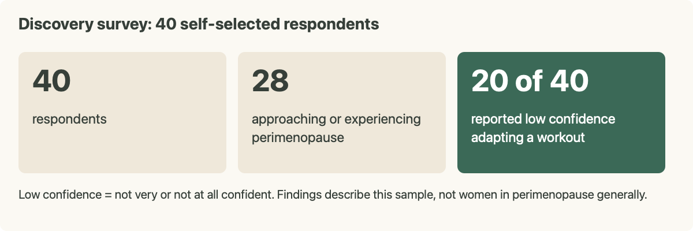
</a>
 
<em>Discovery survey snapshot: sample size, perimenopause self-identification and reported adaptation confidence.</em>

## What I built

My longer-term ambition was to help women build consistency with training that evolves over time. For the three-day hackathon, I focused on adapting today’s workout through one complete visit:

**Welcome → saved setup → daily check-in → adjustable workout preview → guided exercise → reflection → closing.**

The submitted prototype offered strength sessions of approximately 15, 20 and 30 minutes, plus gentle mobility of about 10 minutes. I deferred broader education about perimenopause and exercise because of the time constraint and because I had not secured enough expert sources or professional review to support it. I did include a small set of source-linked general tips on consistency, strength and recovery. A fixed rule chose the tip from saved goals, with a session-type fallback; it was not ongoing coaching or a broader education feature.

I kept access account-free, with setup saved in the browser to reduce repeat questions. Daily answers, workout progress and reflections are held in memory only. The trade-off is no workout history, cross-device access or adaptation across weeks.

<a href="../figures/support-requests.png">
  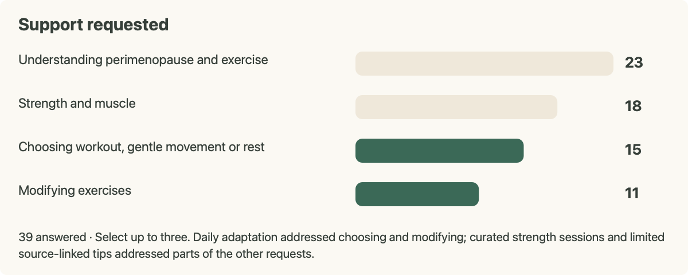
</a>
 
<em>Support requests and the scope choice: daily adaptation, curated strength sessions and a limited educational layer.</em>

## Four decisions that shaped it

### 1. Keep the user in control

The user’s chosen effort sets the ceiling for the recommendation. Energy and rest can suggest a lighter version. On the workout preview, users can select eligible exercise versions or available alternative movements. During a strength exercise, they can change the level for the sets still to do; alternative movements cannot be switched mid-session.

Rest controls include Add 30 s, Pause/Resume and Skip rest. I wanted the recommendation to support a choice without presenting the app as an authority on someone’s body.

<table>
<tr>
<td width="50%" valign="top"><a href="../screenshots/PeriMove_Checkin_Controls.png">
  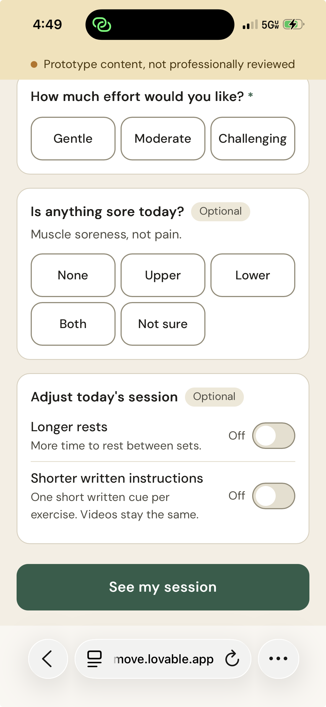
</a></td>
<td width="50%" valign="top"><a href="../screenshots/PeriMove_Rest_Controls.png">
  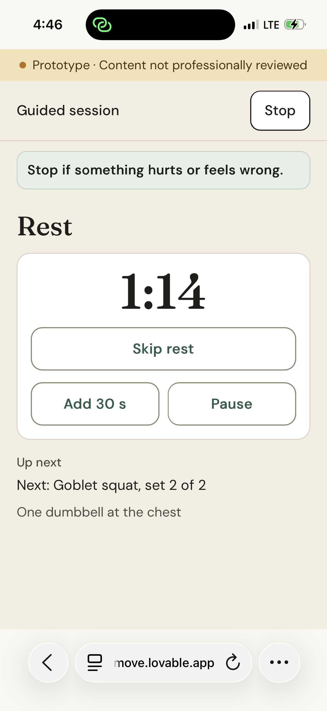
</a></td>
</tr>
<tr>
<td valign="top"><em>Daily check-in: chosen effort, optional soreness, longer rests and shorter written instructions provide inputs for today’s session.</em></td>
<td valign="top"><em>Rest remains adjustable during strength sessions: Skip rest, Add 30 s and Pause are available beside the countdown.</em></td>
</tr>
</table>

Where the rules support an explanation, the app connects suggested changes to the person’s answers. A limitation remained: overlapping reasons could leave an exercise without a nearby explanation.

<table>
<tr>
<td width="50%" valign="top"><a href="../screenshots/PeriMove_02_Guided_Squat.png">
  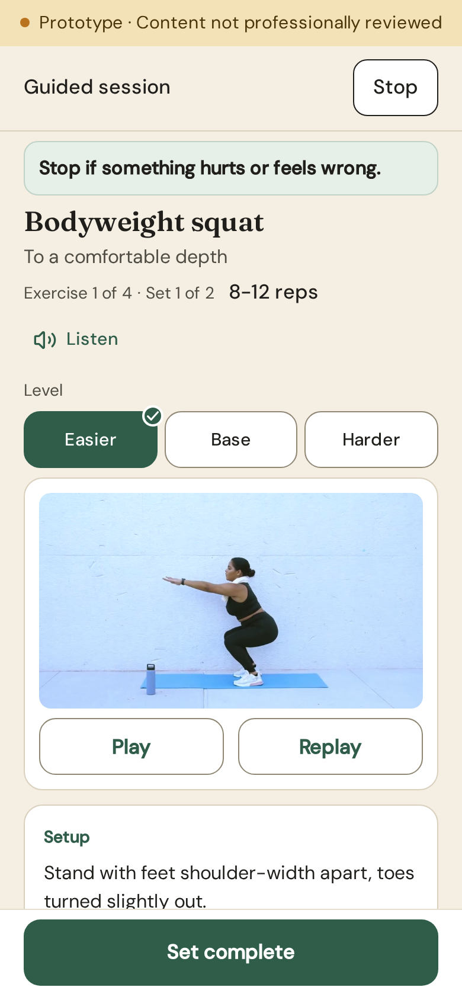
</a></td>
<td width="50%" valign="top"><a href="../screenshots/PeriMove_03_Gentle_Mobility.png">
  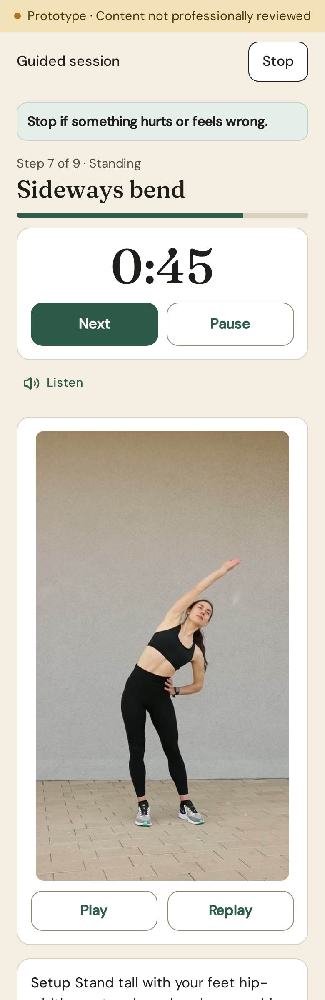
</a></td>
</tr>
<tr>
<td valign="top"><em>Guided strength combines written cues, Listen, a movement demonstration and level choices, with Set complete pinned below.</em></td>
<td valign="top"><em>Gentle mobility uses timed steps with Next and Pause controls, alongside Listen and a movement demonstration. Extended page view.</em></td>
</tr>
</table>

### 2. Rules, not AI, at runtime

I chose explicit recommendation rules and a small curated exercise library. The app selects among predefined sessions and exercise versions, with predefined explanations. It does not use AI to generate workouts or advice.

That made the behavior easier to inspect and test within three days. The trade-off was limited variety: when a combination was unsupported, the app could only offer eligible alternatives or explain what was missing.

The written specification grew from 32 to 62 numbered acceptance cases during the build, according to the reconciled specification. These written cases are separate from the 324 automated tests Lovable reported for the final build; not every written case has been mapped to an automated test.

AI supported research synthesis, planning and implementation review. I retained responsibility for the scope, rules, content and release decisions.

### 3. Treat content as unreviewed

I limited exercises to movements with credible technique references. Where I could not support an addition, I left a gap rather than expand the library to make it appear complete.

The cost was a deliberately small library: for example, the standing strength session has no pulling movement and is not described as full-body. Some exercises have fewer difficulty versions than others.

Technique references do not validate an assembled workout. The sessions, cues, dose and modifications remained draft content, labeled as not professionally reviewed or clinically validated.

### 4. Let observed use reshape the journey

Six usability sessions, five with people in or approaching perimenopause, and a separate product review informed changes to the journey. The evidence included observed confusion and stated ideas. Some findings followed moderator prompting, the earliest records were short summaries, and two testers did not reach reflection.

<a href="../figures/testing-to-changes.png">
  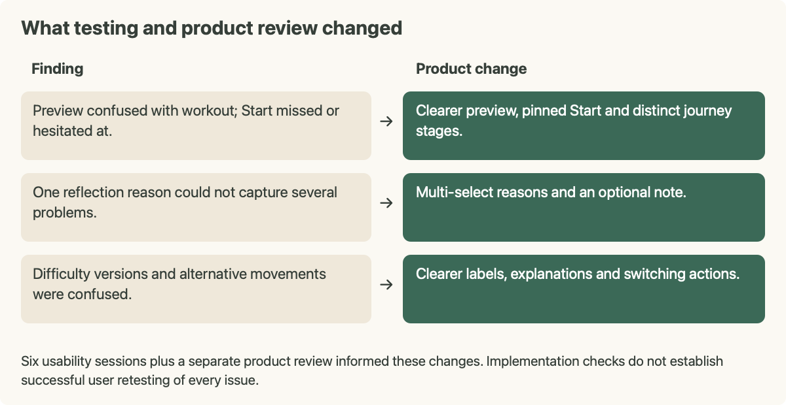
</a>
 
<em>Three documented findings and the product changes they informed.</em>

**Make the preview recognizable.** People missed or hesitated at Start, and the recommendation was not consistently understood as a preview. I clarified the workout summary, simplified the gentle overview and pinned Start. The priority was making the transition from choosing to doing understandable.

<table>
<tr>
<th>Earlier preview</th>
<th>Submitted preview</th>
</tr>
<tr>
<td width="50%" valign="top"><a href="../screenshots/PeriMove_00_Earlier_Preview.png">
  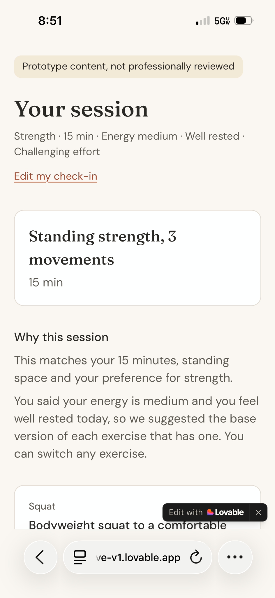
</a></td>
<td width="50%" valign="top"><a href="../screenshots/PeriMove_01_Workout_Preview.png">
  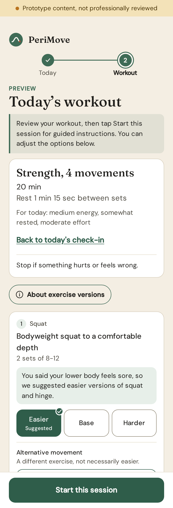
</a></td>
</tr>
<tr>
<td valign="top"><em>Earlier preview: the page was titled “Your session,” and Start was not visible in this captured view.</em></td>
<td valign="top"><em>Submitted preview: explicit preview wording, a summary of today’s choices, an explanation beside the affected exercise and a visible Start action. Extended page view.</em></td>
</tr>
</table>

These captures show different sessions and viewport sizes. They illustrate the design changes rather than a controlled comparison of the same workout.

**Let reflection capture several problems.** A single-choice reason could not describe several things that did not fit. I changed the reasons to multi-select and added optional text. Selections could also be reversed, which I checked separately on my phone.

<a href="../screenshots/PeriMove_Reflection_Multiselect.png">
  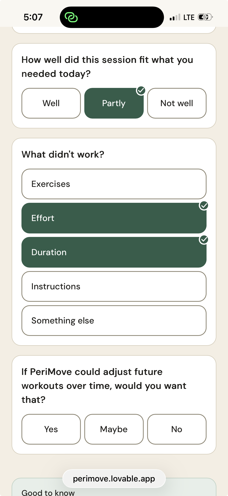
</a>
 
<em>Reflection allows several reasons: Effort and Duration are both selected after choosing Partly.</em>

**Distinguish a version from a different movement.** Exercise difficulty versions and alternative movements were confused. I clarified labels, explanations and switching actions so the distinction was explicit. A related product-review finding exposed lost customization when switching away and back; valid choices were restored, with a separate fix to reset stale choices after meaningful check-in edits.

Testers also raised spoken guidance. I tried it on a limited basis, checked it on my phone, then expanded support. Five demonstration clips and clearer placeholders supported the written instructions.

I prioritized an understandable end-to-end experience over adding more sessions. These changes shipped and received implementation checks; the records do not establish that the same participants successfully retested every issue.

## What I delivered and how I checked it

The prototype connected setup, check-in, adjustable preview, guided movement and reflection. It included written and spoken instructions, five demonstration clips and flexible rest controls. Accounts, workout history and ongoing training plans stayed outside the build.

The reflection can show an effort-based suggestion for a future visit, without saving the answer or updating an ongoing plan.

**Offer a small educational layer.** Understanding perimenopause and exercise was the largest survey request. I couldn’t build and review that broader resource within three days, so I included a small set of source-linked tips on consistency, strength and recovery. Fixed rules selected a tip using saved goals, with a session-type fallback.

<table>
<tr><th>Reflection guidance</th><th>Source-linked tip</th></tr>
<tr>
<td width="50%" valign="top"><a href="../screenshots/PeriMove_Reflection_Effort.png">
  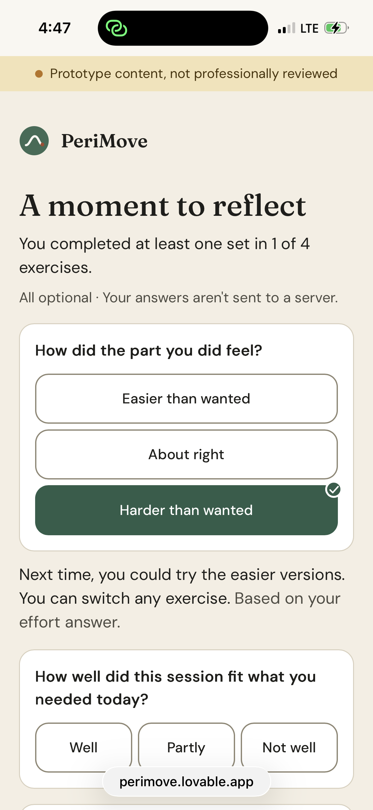
</a></td>
<td width="50%" valign="top"><a href="../screenshots/PeriMove_Sourced_Tip.png">
  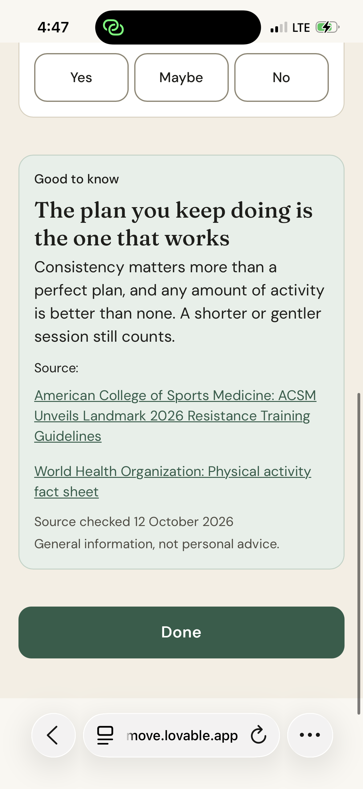
</a></td>
</tr>
<tr>
<td valign="top"><em>Selecting “Harder than wanted” displays a suggestion to consider easier versions next time. This is separate from the multi-select reasons interaction.</em></td>
<td valign="top"><em>A consistency tip includes source links and a general-information notice—limited educational support within the prototype.</em></td>
</tr>
</table>

Lovable reported **324 passing automated tests and a clean production build** for the final submitted build. Those results cover the behaviors tested; they are not user validation.

Separately, I checked the app on my iPhone, including voice starting and stopping, video playback, and restoring or resetting exercise choices after navigation and check-in edits. Usability sessions revealed where people struggled with the experience. Browser simulations were an additional implementation check, not a substitute for those phone checks.

A short-screen limitation remained: the initial strength view still needed scrolling on my phone. Longer-term use, adherence and health outcomes were not evaluated.

## What I would do differently

**Explain the value before asking questions.** The welcome screen introduced PeriMove, but visitors reached setup questions quickly. My retrospective hypothesis is that a brief “how it works” introduction or sample adapted workout would make the experience easier to understand without my explanation.

**Design for mobile and desktop from the start.** Mobile was my primary design and testing target. Desktop did not receive equivalent layout refinement. Next time, I would review both throughout the build.

These are lessons and future experiments, not tested explanations for the project’s reception.

## What comes next

Before wider use, the exercise content needs professional review. A multi-day study could then investigate whether the check-in and adaptation choices fit people’s real routines and whether they return.

The longer-term vision includes training that evolves across perimenopause and education about perimenopause and exercise, supported by expert sources and professional review. These are directions to explore, rather than built capabilities or validated demand.

---
